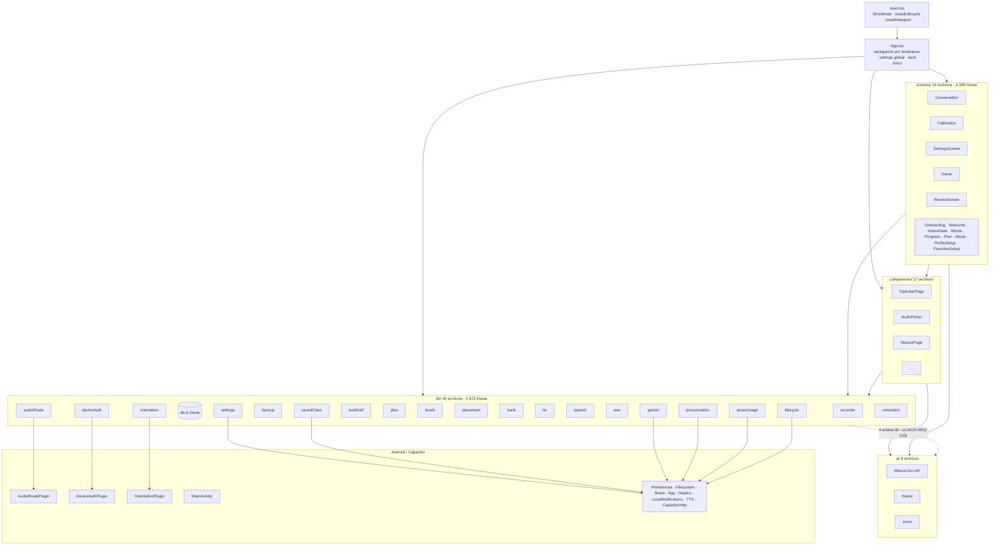

# B1 · Arquitectura real de Habla (v5.8 build 33, commit `6874443`)

Fase 1, solo lectura. Grafo generado con `resultados/B1/arnes/grafo-imports.mjs` (salida completa en `evidencia/grafo-imports.txt`). Hallazgos en `hallazgos.md`.

## 1. Capas y dependencias

Aristas por capa (de `grafo-imports.txt`): `screens→lib` 99, `screens→ui` 36, `screens→components` 34, `components→lib` 45, `components→ui` 27, `lib→lib` 55, `lib→ui` 4, `App→*` 40. No hay `lib→screens` ni `lib→components`.

**Ciclos:** 2 componentes fuertemente conexos (`db/plan/testSummary/placement/levels/teacher/profile` y `settings/phonetics`); todos se cierran con `import type`, así que en ejecución el grafo es acíclico (AUD-ARQ-103).

**Módulos más acoplados:** `lib/db.ts` (fan-in 32), `ui/icons.tsx` (32), `lib/settings.ts` (21), `lib/gemini.ts` (17), `ui/theme.ts` (17). Fan-out: `App.tsx` 38, `Conversation.tsx` 34, `Calibration.tsx` 23, `SettingsScreen.tsx` 22.

## 2. Estado y navegación

- **Sin router.** `App.tsx` decide la pantalla con una cadena de `if`: `splash → !onboarded → !personalized → needsFavs → (!calibrated || retest) → gate → review → lesson → pestañas`, y dentro de pestañas `about → planOpen → tab`. ~15 `useState` + 4 refs espejo (`tabRef`, `settingsRef`, `savedRef`, `retestReadyRef`) (AUD-ARQ-108).
- **Atrás:** una única ref `backHandler`; cada pantalla la registra en un efecto y la pone a `null` en la limpieza.
- **Estado global:** `settings` (incluidas las 3 credenciales) vive en `App` y baja por props; `App.update` es el único escritor de Preferences `habla.settings` (AUD-ARQ-109, AUD-ARQ-112). El perfil no es estado global: cada pantalla lo lee de Dexie (`getProfile`) y varias lo reescriben (AUD-ARQ-105).
- **Recursos en refs:** cada pantalla que graba crea su `Recorder` con `useRef(new Recorder())` (Conversation, Calibration, Review) o perezoso (TopicAskPage). Cancelación: solo `Conversation` usa `AbortController` + `gone()`; `started.current` impide doble arranque.
- **StrictMode** activo (`main.tsx:14`): en desarrollo los efectos se montan dos veces; en el APK (build de producción) no. Las pruebas dinámicas de micro deben darse por buenas solo en el APK (H-B3-6).

## 3. Modelo de datos

| Almacén | Contenido | En la copia | Se borra al importar |
|---|---|---|---|
| IndexedDB `habla` (Dexie) v1: `sessions(++id,startedAt,scenario)`, `turns(++id,sessionId,createdAt)`, `mistakes(++id,sessionId,createdAt,category)`, `profile(id)`; v2: `lookups(++id,createdAt)`; v3: `cards(++id,due,&[source+sourceId])` | clases, turnos (transcripciones, correcciones, pronunciación), errores, perfil (niveles, tests con resumen, plan, trayectoria, uso del banco), consultas, tarjetas FSRS | Sí (`backup.ts` `TABLES`) | Sí (se sustituye) |
| IndexedDB `habla-draft` / `kv` / `calibration` | borrador del test terminado sin evaluar, **con audio base64** | No | No (AUD-ARQ-115) |
| Preferences `habla.settings` (`CapacitorStorage.xml`) | ajustes + `geminiKey`, `azureKey`, `azureClientSecret` | No (por diseño, D-02) | No |
| Preferences `habla.savedClass` | clase en progreso: prompt de sistema (con perfil), historial completo, `sessionId` | No | No → puede apuntar a otra sesión tras importar (AUD-ARQ-101) |
| localStorage `habla.netlog` | últimas 120 llamadas a Gemini (modelo, tamaño, tiempos, tokens, 50 primeras letras del prompt de sistema, error) | No | No |
| localStorage `habla.quota` | modelos/cuotas agotadas y hasta cuándo | No | No (se limpia al cambiar de clave) |
| localStorage `habla.azureUsage` | caché del consumo mensual de Azure | No | No |
| localStorage `habla.adviceCursor` | índice del consejo de la mascota | No | No |
| `Documents/Habla/*.json`, `Cache/*.json` | copias exportadas y resúmenes de test guardados | — | — (H-B4-4) |

Migraciones Dexie: solo aditivas, sin `upgrade()`; correctas. La copia tiene `VERSION = 1` independiente de `db.verno` (3): no hay forma de detectar una copia de un esquema futuro ni de migrar una antigua (AUD-ARQ-102).

## 4. Tabla de módulos (principales)

| Módulo | Responsabilidad | Tamaño | Depende de | Riesgos |
|---|---|---|---|---|
| `App.tsx` | arranque, navegación, avisos, back, tema, recordatorios, orientación | 643 l. (función 538) | 38 internos, `@capacitor/app`, `core` | AUD-ARQ-108/109/112 |
| `screens/Conversation.tsx` | clase: micro, Gemini, TTS, guardado, informe, plan, nivel, chat, consultas | 1 044 l. (976) | 34 internos | AUD-ARQ-100/111, AUD-ARQ-001 |
| `screens/Calibration.tsx` | test de nivel completo (7 pasos), micro, borrador, evaluación | 1 433 l. (775) | 23 | AUD-ARQ-100/111/115, H-B3-5 |
| `screens/SettingsScreen.tsx` | ajustes, claves con huella, modelos, Azure, diagnóstico, copia, perfil, tests | 972 l. | 22 | AUD-ARQ-111 |
| `screens/ReviewScreen.tsx` | repaso FSRS oral | 280 l. | 12 | AUD-ARQ-100 |
| `components/TopicAskPage.tsx` | tema libre/debate con dictado | 166 l. | 9 | AUD-ARQ-100 (H-B3-3) |
| `ui/Mascot.tsx` | mascota animada (clase React, rAF) | 1 012 l. | 0 | AUD-ARQ-110 |
| `lib/recorder.ts` | micro: abrir, detectar silencio, alternativas, grabar, cerrar; registro global | 254 l. | 0 | AUD-ARQ-100 |
| `lib/lifecycle.ts` | segundo plano: cierra micros, calla TTS, avisa | 55 l. | recorder, tts | correcto (AUD-ARQ-114) |
| `lib/gemini.ts` | HTTP, reintentos, respaldo, cuota, netlog, esquemas | 593 l. | geminiTrouble | AUD-ARQ-107 |
| `lib/db.ts` | esquema Dexie y tipos de dominio | 243 l. | (tipos) plan, testSummary, pronunciation | AUD-ARQ-103 |
| `lib/backup.ts` | exportar/importar Dexie | 106 l. | db, Filesystem, Share | AUD-ARQ-101/102 |
| `lib/settings.ts` | ajustes + secretos en Preferences | 124 l. | ui/theme, gemini | AUD-ARQ-103/109 |
| `lib/savedClass.ts` | clase en progreso | 60 l. | db, fluency | AUD-ARQ-101/115 |
| `lib/testDraft.ts` | borrador del test en IndexedDB propia | 50 l. | — | AUD-ARQ-115 |
| `lib/plan.ts` | plan de 12 semanas (Gemini) y progreso | 399 l. | db, gemini, profile, teacher | AUD-ARQ-105 |
| `lib/levels.ts`, `placement.ts`, `bank.ts`, `fluency.ts`, `srs.ts` | reglas de nivel, test adaptativo, corrección de respuestas, métricas, repaso | 132/193/251/158/170 l. | db, levels, ts-fsrs | sin tests (AUD-ARQ-113) |
| `lib/audioRoute.ts` + `AudioRoutePlugin.java` | ruta de audio con auriculares | 85 + 247 l. | — | AUD-ARQ-104 |
| `lib/deviceAuth.ts` + `DeviceAuthPlugin.java` | confirmación con bloqueo del teléfono | 36 + 98 l. | — | gate solo de UI (AUD-ARQ-109) |
| `OrientationPlugin.java`, `MainActivity.java` | orientación forzada; pausa del WebView en `onStop` | 34 + 45 l. | — | correcto |

## 5. Recursos de sistema

| Recurso | Quién abre | Quién cierra | Caminos en que puede quedar abierto |
|---|---|---|---|
| `MediaStream` (micro) | `Recorder.open()` `recorder.ts:180`, `fallback()` `:219` | `Recorder.close()` `:298-308`; `releaseAllMics()` (segundo plano) `:126`; `releaseIfIdle()` (`devicechange`, cambio de modo) | Aperturas solapadas → stream huérfano; `close()` durante `getUserMedia` → stream llega tras el cierre/segundo plano; `catch` de `open()` sin `close()` (B0) — AUD-ARQ-100 |
| `MediaRecorder` | `Recorder.start()` `:246` | `stop()` `:273`, `close()` `:300` | `begin()` que termina tras desmontar la pantalla (Calibration, Review, TopicAskPage) — AUD-ARQ-100 |
| `AudioContext` medición | `hasSignal` `recorder.ts:134` | `finally` `:150` | — (bien) |
| `AudioContext` análisis | `analyzeSpeech` `speech.ts:14-19` | `finally` `:23` | — |
| `AudioContext` + `OfflineAudioContext` | `toWav16k` `wav.ts:46,50` | `finally` `:58` (el offline se libera solo) | — |
| TTS nativo | `speak` `tts.ts:109` | `stopSpeaking` (`lifecycle`, limpiezas de pantallas, `leave/finish`) | ninguno detectado |
| Modo de audio / dispositivo de comunicación / SCO | `AudioRoutePlugin.setRoute('headset')` | `setRoute('phone')`, `handleOnStop`, `handleOnDestroy`, `AudioPicker` (appStateChange) | rechazo sin dispositivo o excepción → `MODE_IN_COMMUNICATION` en primer plano — AUD-ARQ-104 |
| `AudioDeviceCallback` nativo | `AudioRoutePlugin.load` | `handleOnDestroy` | — |
| Listeners Capacitor (`backButton`, `appStateChange`×2, `devicesChanged`) | `App`, `AudioPicker`, `audioRoute`, `lifecycle` | `remove()` en limpieza (los de `lifecycle` son de por vida, a propósito) | — |
| Listeners DOM (`visibilitychange`, `pagehide`, `resize`, `orientationchange`, `devicechange`) | `lifecycle`, `viewport`, `recorder` (módulo) | de por vida (singleton) | — |
| `requestAnimationFrame` | cada `Mascot` montada | `componentWillUnmount` | nunca se duerme mientras está montada — AUD-ARQ-110 |
| `setInterval` (cronómetros, cuenta atrás, mensajes) | Conversation, Calibration, Review, PrepareScreen, WelcomeScreen | `clearInterval` en limpieza | — |
| Peticiones HTTP (CapacitorHttp) | `gemini.post`, `pronunciation.postBinary`, `azureUsage.request` | no cancelables; `AbortSignal` solo descarta | siguen hasta `readTimeout` (90 s Gemini, 45 s Azure; `azureUsage` sin límite) — AUD-ARQ-107 |
| Conexión IndexedDB `habla-draft` | `testDraft.open` por operación | `db.close()` en `finally` | — |
| Notificaciones locales programadas | `syncReminders` | `syncReminders` (reprograma) | fuera de alcance de B1 (ver B0: `POST_NOTIFICATIONS` denegado) |

## 6. Plugins nativos

- **Hilos:** `AudioRoutePlugin` registra el callback en el `Looper` principal; los `@PluginMethod` corren en el hilo del puente; `DeviceAuth`/`Orientation` saltan al hilo de UI con `runOnUiThread`. Sin estado compartido entre hilos más allá de `am`.
- **Si el JS muere:** `handleOnStop` suelta la ruta de audio; `MainActivity.onStop` pausa el WebView. El micro del WebView lo libera Chromium al pausar/destruir el renderer (no verificado: H-B3-2).
- **SDK < 31:** ruta SCO por `startBluetoothSco` también con cable; `setSpeakerphoneOn(false)` sin restaurar (AUD-ARQ-104). `DeviceAuth` usa `KeyguardManager` en < 30 (correcto). `isHeadset` omite `TYPE_USB_DEVICE`/`TYPE_HEARING_AID` (menor).

## 7. Build

`build.gradle`: firma `habla` condicionada a que exista `keystore.properties` (AUD-ARQ-106); solo se copia la variante debug (AUD-SEG-001); `minifyEnabled false` en release; `versionCode/versionName` desde `version.json` (bien: una sola fuente). `capacitor.config.ts`: `loggingBehavior: 'none'` (correcto). `variables.gradle`: min 24 / target 36.

## 8. Lo no cubierto

- `Home.tsx`, `WelcomeScreen.tsx`, `Onboarding.tsx`, `NoticeGate.tsx`, `ProgressScreen.tsx`, `PlanScreen.tsx` y `reminders.ts` solo se revisaron a nivel de grafo y de efectos/recursos (grep), no línea a línea: sus flujos son de B2.
- `tts.ts` revisado solo en su interfaz (`speak`/`stopSpeaking`); el detalle de voces es de B3.
- Sin pruebas dinámicas (fase 1): todo efecto en ejecución queda como HIPÓTESIS.
