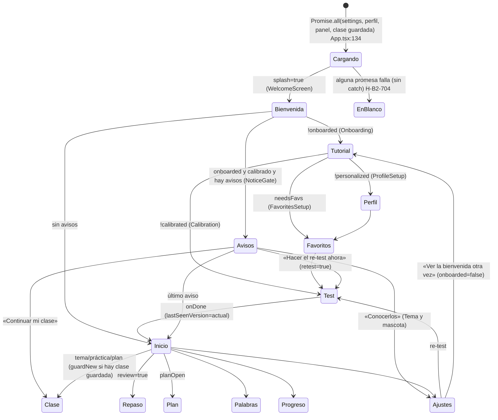
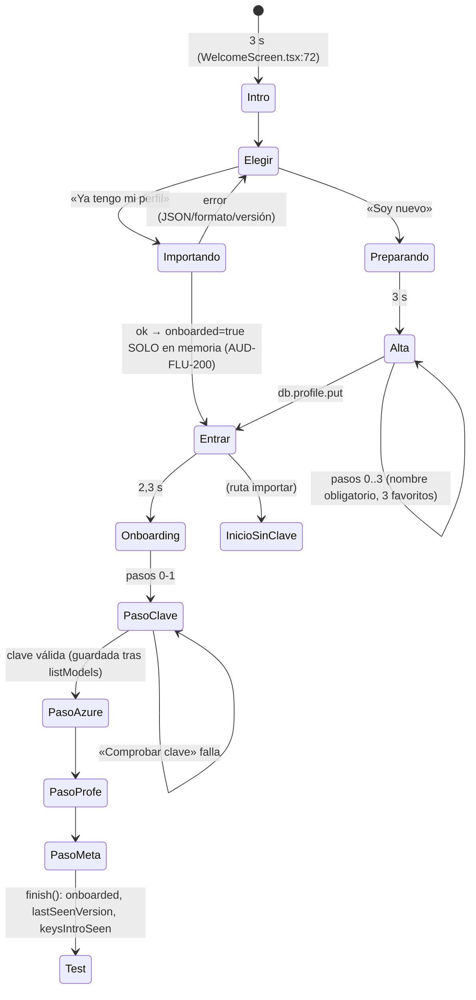
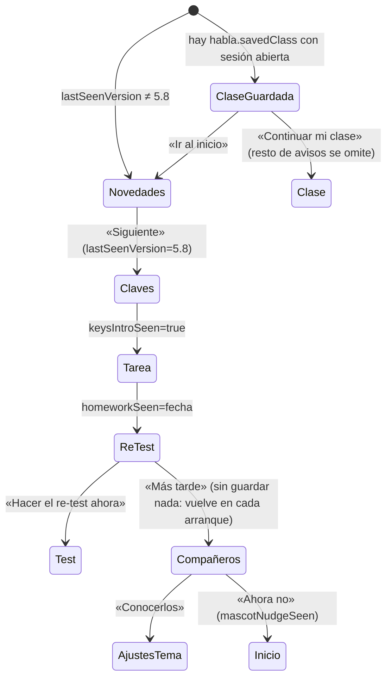
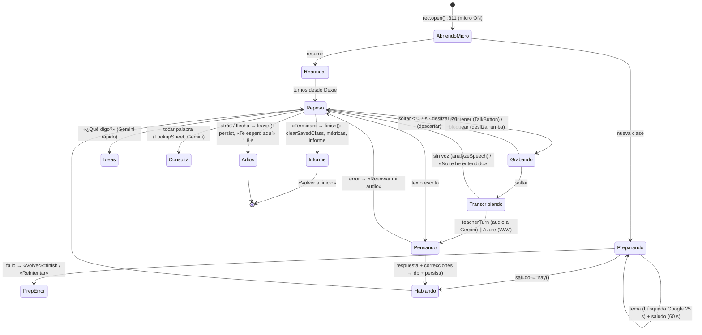
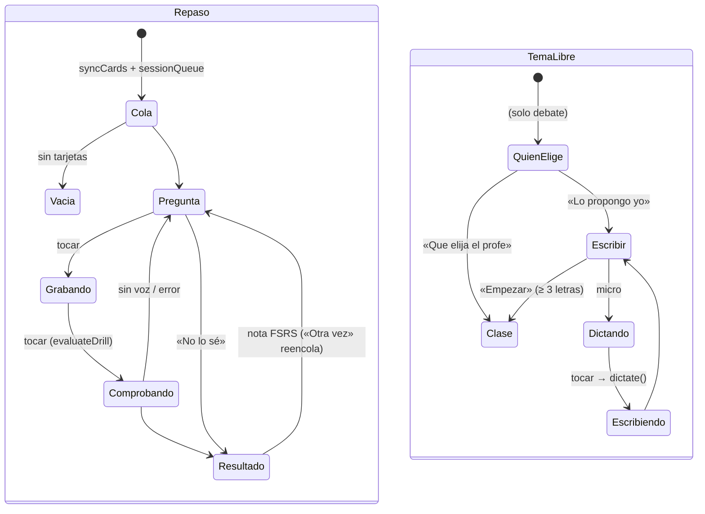

# B2 · Mapas de flujo (fase 1, estática)

Commit `6874443` (v5.8 build 33). Fuente: lectura de código. «Micro» = micrófono abierto (indicador verde). «Sale» = datos que salen del teléfono. Hallazgos en `hallazgos.md`; casos en `casos-e2e.md`.

## 0. Arranque y enrutado (`src/App.tsx`)

`App` decide la pantalla por este orden (`App.tsx:261-437`): `splash` → `!onboarded` → `!personalized` → `needsFavs` → `!calibrated || retest` → `gate.length` → `review` → `lesson` → pestañas.



**Botón atrás de Android** (`App.tsx:229-239`): `backHandler` de la pantalla → si no, pestaña ≠ Inicio → Inicio → si no, alterna `askExit`. Antes del Inicio no hay manejador y el diálogo no se pinta (AUD-FLU-201). En el test, atrás está anulado (AUD-FLU-202).

**Superposiciones globales**: `AudioPicker` (siempre), `PhoneticsAlert` y `GeminiTroubleSheet` (solo si `onboarded`; **no** durante el test, AUD-FLU-208). `PhoneticsAlert` puede cortar una clase (AUD-FLU-207).

## 1. Primera instalación

Orden real del código (difiere del de la misión): **Bienvenida (nombre → compañero → a qué se dedica → 3 favoritos; o importar copia)** → **Tutorial de la mascota (`Onboarding`, 6 pasos: hola · cómo funciona · clave de Gemini · Azure informativo · profe · meta)** → (perfil/favoritos ya hechos en la bienvenida) → **Test de nivel** → **Inicio**.



| Disparador | Qué hace el código | Estado final | Micro | Progreso guardado | Sale del teléfono |
|---|---|---|---|---|---|
| «Soy nuevo» + 4 pasos | `db.profile.put` (`WelcomeScreen.tsx:106-115`) | Tutorial | no | perfil en IndexedDB | nada |
| Importar copia válida | `importBackup` borra y sustituye tablas; `onboarded` solo en memoria | Inicio sin clave | no | sí (tablas) | nada |
| Importar copia sin nombre | `throw` → mensaje | Bienvenida | no | **las tablas ya se sustituyeron** antes del error (`App.tsx:181-183`) | nada |
| «Abrir Google AI Studio» | `<a href>` → navegador | vuelve al mismo paso si el WebView sigue vivo | no | clave no guardada aún | navegación externa |
| «Comprobar clave» ok | `listModels` (R1) y `update` | paso Azure | no | clave en Preferences | **clave en cabecera a Google** |
| «Comprobar clave» falla / sin red | mensaje de error | mismo paso, «Continuar» deshabilitado | no | — | intento a Google |
| Elegir profe | `speak` de prueba | — | no | ajustes | nada (TTS local) |
| «Continuar al test» | `finish()` | Test | no | ajustes | nada |
| Atrás de Android en cualquier paso | `askExit` alterna sin verse | sin cambio | no | — | — |

**Atascos posibles:** ninguno duro; el paso de la clave exige una clave válida y red (sin red no se puede terminar el tutorial, comportamiento esperado). Nota: si la importación falla por «sin nombre», las tablas ya se habían reemplazado.

## 2. Usuario que actualiza / vuelve (`NoticeGate`)

Se calculan una vez en `endSplash` (`App.tsx:160-177`) y solo si `onboarded && personalized && calibratedAt`. Orden (`notices.ts:130-142`): `savedClass` → `news` → `keysIntro` → `homework` → `retest|recalibrate` → `companions`.



| Disparador | Código | Final | Micro | Guarda | Sale |
|---|---|---|---|---|---|
| Continuar clase | `setGate([])` + `resumeClass()` | Clase (reanudada) | **sí, al montar** | — | ver §3 |
| Novedades «Siguiente/Entrar» | `update({lastSeenVersion})` | siguiente | no | ajustes | nada |
| Re-test ahora | `setRetest(true)` | Test sin salida (AUD-FLU-202) | en habla | no hasta el final (AUD-FLU-203) | ver §4 |
| Atrás de Android | `askExit` invisible | sin cambio | no | — | — |

Si se elige «Continuar mi clase», los avisos `news`/`keysIntro` se posponen al siguiente arranque (no se pierden).

## 3. Clase de conversación (`Conversation.tsx`)



| Disparador | Código | Final | ¿Micro liberado? | ¿Progreso guardado? | Sale del teléfono |
|---|---|---|---|---|---|
| Entrar | `rec.open()` antes de todo | Preparando | **no: se abre** (AUD-FLU-213, H-B2-302) | sesión creada | perfil + errores recientes en el prompt; tema con búsqueda |
| Mantener y soltar | `begin` → `stop` → `analyzeSpeech` → `askTeacher` | Pensando | stream sigue abierto | turno y errores en Dexie, `habla.savedClass` | **audio webm** (+ WAV a Azure si fonética) |
| Error transitorio | `setError` + `canRetry` | Reposo | abierto | audio solo en memoria (AUD-FLU-218) | reintentos (AUD-FLU-212) |
| «¿Qué digo?» | `answerIdeas` | Reposo | abierto | no | último mensaje del profe + tema |
| Tocar palabra | `LookupSheet` | Hoja | abierto | consulta en Dexie (si se guarda) | palabra + frase |
| Atrás / flecha | `leave()` | Inicio | **sí** (`close`) | sí (o borra sesión vacía) | nada; peticiones abortadas |
| Terminar | `finish()` | Informe | **sí** | sesión cerrada, lección del plan | transcripción completa para el informe |
| Segundo plano | `releaseAllMics` + `persist` | misma pantalla | sí (UI puede seguir en «grabando», AUD-FLU-214) | sí | respuestas pendientes siguen llegando (AUD-FLU-215) |
| Aviso de fonética agotada → «Ver Ajustes» | `setLesson(null)` | Ajustes | sí (limpieza) | lo ya persistido | — (AUD-FLU-207) |
| Girar | `configChanges` (no remonta) | igual | — | — | — |

**Atascos:** preparación sin botón visible (AUD-FLU-213); `bye` anula el atrás 1,8 s (intencionado).

## 4. Test de nivel y re-test (`Calibration.tsx`, `testDraft.ts`)

```mermaid
stateDiagram-v2
  [*] --> Cargando: getProfile + loadDraft
  Cargando --> Evaluando: hay borrador (runEval)
  Cargando --> Explicacion: sin borrador
  Explicacion --> Gramatica: «Empezar el test» (sin salida en re-test, AUD-FLU-202)
  Gramatica --> ResumenG: grammarShouldStop
  ResumenG --> Lectura1
  Lectura1 --> ResumenL1 --> Lectura2 --> ResumenL2
  ResumenL2 --> Audicion1: vista previa 35 s, máx. 3 escuchas con nota
  Audicion1 --> ResumenA1 --> Audicion2 --> ResumenA2
  ResumenA2 --> Habla1: tarea 1 (tocar para grabar)
  Habla1 --> Habla2: grabado o saltado
  Habla2 --> Decidiendo: espera pre-evaluaciones ≤ 25 s
  Decidiendo --> Habla3
  Habla3 --> Evaluando: finish(): close micro, saveDraft ×2
  Evaluando --> Resultado: evaluate() ok → saveCalibration, clearDraft
  Evaluando --> EvalFail: error → «Reintentar» (+ GeminiFix)
  EvalFail --> Evaluando: loadDraft (si no hay, nada: AUD-FLU-205)
  Resultado --> [*]: onDone (re-test: adaptPlanAfterTest)
```

| Disparador | Código | Final | Micro | Guardado | Sale |
|---|---|---|---|---|---|
| Responder gramática/lectura | estado React | siguiente | no | **no** (AUD-FLU-203) | nada |
| Escuchar audio | TTS local, `plays` +1 | — | no | no | nada |
| Grabar tarea | `begin` / `stop` / `assessSpeakingTask` en paralelo | misma tarea | **abierto hasta `finish`** (H-B2-304) | no | **audio** a Gemini (pre-evaluación) |
| Fallo de micro | `micFailures++` → «Saltar» | — | — | — | — |
| Terminar | `saveDraft` → `evaluateSpeaking` | Resultado | cerrado | borrador → resultado en perfil | audios + respuestas fallidas |
| Atrás | `registerBack(() => {})` | nada | — | — | — |
| Matar app | — | primer test: desde cero; re-test: Inicio | — | **se pierde** | — |
| Fallo de evaluación del re-test + cerrar | borrador huérfano | Inicio | — | borrador con audios (AUD-FLU-204) | — |

Reglas verificadas en código (para B6): 70/30 = `TEST_WEIGHT` en `levels.ts` (`finalLevels`); «las lecciones solo proponen» = `updateTrajectoryFromPractice` en `Conversation.tsx:569`, que no cambia el nivel; `recalibrate` sustituye sin ponderar (`recalPage`).

## 5. Repaso, Palabras y Tema libre/Debate



| Pantalla / disparador | Micro | Guarda | Sale | Notas |
|---|---|---|---|---|
| Repaso: grabar | abierto hasta salir del repaso (H-B2-303) | FSRS al puntuar | audio a Gemini | sin `AbortController`: tras salir aún habla (AUD-FLU-215) |
| Repaso: salir | `close` en limpieza | lo puntuado | — | atrás = `onExit` |
| Palabras: consultar | no | historial en Dexie | palabra + contexto | atrás cierra el detalle |
| Tema libre: dictar | abierto solo grabando; `close` tras parar | no | audio a Gemini (rápido) | estado «grabando» tras segundo plano (AUD-FLU-214) |

## 6. Plan de 12 semanas y recordatorios

| Disparador | Código | Final | Sale | Notas |
|---|---|---|---|---|
| Inicio montado, calibrado, con clave, sin plan | `PlanCard` → `createPlan` automático | tarjeta con lección | perfil/nivel a Gemini | reintento automático en cada montaje (AUD-FLU-216) |
| Semana sin lecciones | `ensureWeekLessons` automático | — | idem | `PlanScreen` puede lanzar la misma a la vez |
| Empezar lección | `startPlanLesson` → `guardNew` | Clase | ver §3 | no comprueba clave |
| ≥ 3 respuestas y Terminar | `markLessonDone` | informe «¡Lección completada!» | — | salir con atrás no la marca |
| Re-test terminado | `adaptPlanAfterTest` | plan rehecho | sí | en paralelo a `PlanCard` |
| Recordatorio | 7 avisos `LocalNotifications` + re-test a las 10:00 | — | nada | sin permiso no programa; caduca a 7 días (AUD-FLU-217) |

## 7. Ajustes

| Disparador | Código | Final | Bloqueo | Sale |
|---|---|---|---|---|
| Ojo de la clave (Gemini/Azure) | `confirmIdentity` | clave visible | sí (gracia 60 s global, H-B2-501) | nada |
| Guardar clave distinta | `confirmIdentity` → **guardar** → `listModels` | clave nueva aunque sea inválida (AUD-FLU-209) | sí | clave a Google |
| Comprobar clave guardada | `listModels` | — | no | clave a Google |
| Azure clave | `confirmIdentity` → `checkAzureKey` → guardar | — | sí al cambiar | clave a Azure (R4) |
| Secreto del *service principal* | `confirmIdentity` → guardar → consumo | — | sí al cambiar | secreto a login.microsoftonline (R5) |
| Diagnóstico | lee `habla.netlog` | — | no | nada |
| Exportar | JSON en `Documents/Habla` + `cache` + Compartir | — | no | lo que elija el usuario |
| Importar | sustituye tablas; no limpia clase guardada ni borrador (AUD-FLU-219) | — | no | nada |
| Ver la bienvenida otra vez | `onboarded=false` | Tutorial (clave «ya guardada ✓») | — | — |
| Orientación | `applyOrientation` | — | — | — |
| Re-test | `setRetest(true)` | Test sin salida | — | ver §4 |

## 8. Errores de IA

| Situación | Origen | Qué ve el usuario | Recuperación |
|---|---|---|---|
| Sin clave | `keysReady` falso | Inicio: los temas mandan a Ajustes (portada) sin explicación; el plan no aparece | Ajustes → Gemini |
| Clave inválida (400 API_KEY_INVALID/401/403) | `describeError`, `keyError` | mensaje + hoja de la mascota (`trouble: key`) | `GeminiFix`/Ajustes (riesgo AUD-FLU-209) |
| 429 | `markExhausted`, salto al respaldo | «sin cuota» + hoja (`quota`, «Ahora no» 10 min) | otro modelo |
| 503/5xx | 3+2 reintentos, 60 s | clase: «sigue sin responder… Reenviar»; test: «Google está saturado» | reintentar |
| Sin red | igual que 503 (estado 0) | **«Google está saturado»** (AUD-FLU-212) | reintentar |
| Respuesta vacía/JSON roto | `ApiError(…, 200, true)` | «Respuesta de Gemini incompleta» tras reintentos | reintentar |
| Bloqueo de seguridad | `promptFeedback.blockReason` | «Gemini bloqueó este mensaje» | reformular |
| En el test | `EvalFail` + `GeminiFix` | sin hoja global (AUD-FLU-208) | reintentar |
